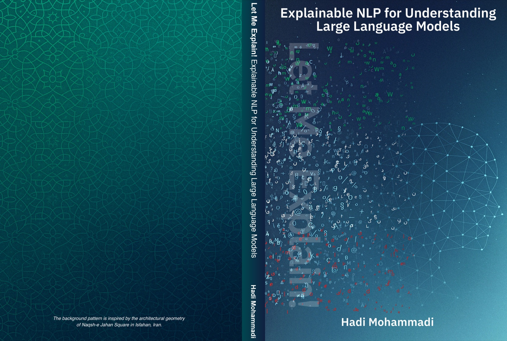

# Hadi Mohammadi, PhD

**Senior AI & Data Science Expert – R&D Specialist** at [AcademicTransfer](https://www.academictransfer.com) 
**PhD in Explainable NLP**, [Utrecht University](https://www.uu.nl/staff/HMohammadi), 2026

*I build production LLM and ranking systems, and research explainable NLP and LLM evaluation.*

---

## Research

  

### *Let Me Explain! Explainable NLP for Understanding Large Language Models*

Utrecht University · defended 9 September 2026 · [doi:10.33540/3756](https://doi.org/10.33540/3756) · [thesis page](https://mohammadi.cv/thesis/) · [read online](https://mohammadi.cv/thesis/flipbook/)

The thesis asks why a language model gives the answer it does, and whether that explanation can be trusted. Its six studies cover three gaps: explanation methods that work on text, the reliability of LLM-produced annotations under demographic bias, and the cross-cultural moral alignment of LLMs. Promotors Dr. Robert A. Bagheri and Prof. dr. Daniel L. Oberski, co-promotor Dr. Anastasia Giachanou. Each chapter's paper has a public repository with citation metadata and a tagged release.

| Ch. | Paper | Venue | Links |
|---|---|---|---|
| 2 | Explainability in Practice: A Survey of Explainable NLP Across Various Domains | under review, *Journal of Information Science* | [arXiv](https://arxiv.org/abs/2502.00837) · [code](https://github.com/mohammadi-hadi/xnlp-survey) |
| 3 | A Transparent Pipeline for Identifying Sexism in Social Media: Combining Explainability with Model Prediction | *Applied Sciences* 14(19), 2024 | [doi](https://doi.org/10.3390/app14198620) · [code](https://github.com/mohammadi-hadi/Explainable-Sexism-Detection) |
| 4 | Explainability-Based Token Replacement on LLM-Generated Text | arXiv preprint, 2025 | [arXiv](https://arxiv.org/abs/2506.04050) · [code](https://github.com/mohammadi-hadi/Token-Replacement) |
| 5 | Assessing the Reliability of LLMs Annotations in the Context of Demographic Bias and Model Explanation | GeBNLP @ ACL 2025 | [ACL Anthology](https://doi.org/10.18653/v1/2025.gebnlp-1.9) · [arXiv](https://arxiv.org/abs/2507.13138) · [page](https://mohammadi.cv/ACL2025/) · [code](https://github.com/mohammadi-hadi/Explainable_Annotations_Reliability) |
| 6 | Exploring Cultural Variations in Moral Judgments with Large Language Models | *CLIN Journal* 15, 2026 | [journal](https://clinjournal.org/clinj/article/view/238) · [arXiv](https://arxiv.org/abs/2506.12433) · [code](https://github.com/mohammadi-hadi/cultural-moral-judgments-llms) |
| 7 | EvalMORAAL: Interpretable Chain-of-Thought and LLM-as-Judge Evaluation for Moral Alignment in Large Language Models | \*SEM 2026 | [ACL Anthology](https://aclanthology.org/2026.starsem-conference.34/) · [arXiv](https://arxiv.org/abs/2510.05942) · [code](https://github.com/mohammadi-hadi/EvalMORAAL) |

### Other recent papers

| Paper | Venue | Links |
|---|---|---|
| Chain-of-Thought Faithfulness Under GRPO and DPO Fine-Tuning | INLG 2026, long paper | [INLG](https://2026.inlgmeeting.org/accepted-papers.html) · [preprint](https://arxiv.org/abs/2512.22631) · [code](https://github.com/mohammadi-hadi/grpo_dpo_comparison) · [adapters](https://huggingface.co/hadimh93/qwen2.5-gsm8k-grpo-dpo-adapters) |
| trajectory-judge: What Outcome-Only LLM Judges Miss on Agent Trajectories | NeurIPS 2026 workshop *Who Verifies the Agents?* | [arXiv](https://arxiv.org/abs/2609.00038) · [code](https://github.com/mohammadi-hadi/trajectory-judge) |
| Judging Without Gold: Gold-Free Estimation of LLM-Judge Accuracy and Its Failure Modes | NeurIPS 2026 workshop *Can We Trust the Judge?* | [code](https://github.com/mohammadi-hadi/judgepanel) |
| Reliability-Aware Sexism Detection: Combining DPO with Annotator Agreement and Token-Level Confidence Scoring | preprint, under review at EACL 2027 | [arXiv](https://arxiv.org/abs/2608.12330) · [code](https://github.com/mohammadi-hadi/RA-DPO) |
| Learning Sexism Detection Using Multi-Agent Perspectivist Preference Optimization | preprint | [arXiv](https://arxiv.org/abs/2608.04056) · [code](https://github.com/mohammadi-hadi/MAP-PO) |
| Do Large Language Models Understand Morality Across Cultures? | LUHME @ ECAI 2025 | [ACL Anthology](https://aclanthology.org/2025.luhme-1.3/) · [code](https://github.com/mohammadi-hadi/cultural-moral-judgments-llms) |

The full list of 20 publications is on [mohammadi.cv](https://mohammadi.cv/publications/). Recognition: Best Oral Presentation at the IOPS Winter Conference 2025 for the work on cultural moral alignment, and €40K+ in competitive grants across five projects.

---

## Experience

**AcademicTransfer**, Utrecht (2024–present)

- Lead the company's 2026 WBSO R&D programme: an MCP-based academic query engine and an explainable CV matching engine with recruiters in the loop.
- Technical lead of the AI layer and applicant-tracking system behind the recruitment platform of 22 Dutch research universities and university medical centres, which reads 10,000+ applications a month.
- Cut time-to-hire by 20% with the CV Priority Sorter (active learning and LLMs), built with Utrecht University, TU Delft and Maastricht University.
- Raised candidate–job matching accuracy by 17% and halved manual effort with generative pipelines for CV insight extraction and de-identification.

| Years | Role | What I built |
|---|---|---|
| 2024–2025 | Researcher & NLP Developer, FIRMBACKBONE, Utrecht University School of Economics | [fbb-sustainability-analysis-cli](https://github.com/Firmbackbone/fbb-sustainability-analysis-cli): keyword extraction and sustainability scoring of company websites |
| 2021–2023 | Senior Data Scientist, Customer Behaviour, SnowaTec (Entekhab Electronic), Tehran | Customer segmentation (+7.5% marketing impact); a modernised data warehouse and ETL (+16% data accessibility) |
| 2019–2020 | Data Scientist, then Head of Data Science & BI, Bdood.bikes, Tehran | Dynamic pricing and usage prediction (+5% revenue); fleet intelligence (−8% maintenance costs), including a [Streamlit operations dashboard](https://github.com/mohammadi-hadi/bicycle-transportation-intelligence) with GeoPandas geofencing and H3 maps |

---

## Open source

The evaluation libraries are one line of work rather than a collection. Each takes a single way evaluation goes wrong — a judge with a position bias, a label set nobody checked, a leaderboard read past its own confidence intervals, an experiment called too early — and makes it measurable, with the headline finding stated as a number instead of a claim. [evalstack](https://github.com/mohammadi-hadi/evalstack) maps all eleven, including raterkit, retainkit, calikit, abeval, arenakit and judgewatch: what each measures, what it found, and the two chains that run end to end.

### Evaluation

- [EvalMORAAL](https://github.com/mohammadi-hadi/EvalMORAAL) — chain-of-thought plus LLM-as-judge evaluation of moral alignment, benchmarking 20 LLMs across 64 countries against the World Values Survey and PEW.
- [trajectory-judge](https://github.com/mohammadi-hadi/trajectory-judge) — how much an LLM judge misses when an agent reaches the right answer the wrong way: a tool-using environment with injected faults, five judges compared on detection, step localisation, fault typing, calibration and cost.
- [judgekit](https://github.com/mohammadi-hadi/judgekit) — bias probes for LLM judges, each with a bootstrap confidence interval: position, verbosity, self-preference and calibration, where qwen2.5:14b picks whichever answer is shown first 77% of the time.
- [judgepanel](https://github.com/mohammadi-hadi/judgepanel) — estimate how accurate your judges are without any gold labels: Dawid–Skene EM over the disagreement pattern alone, which exposes a flag-everything judge exactly (estimated specificity 0.000).
- [abkit](https://github.com/mohammadi-hadi/abkit) — sample-ratio mismatch, peeking, multiple testing and winner's-curse checks for experiment readouts, applied to 4,873 real Upworthy tests where 15% fail the sample-ratio check.
- [explainkit](https://github.com/mohammadi-hadi/explainkit) — explain the classifier, then test the explanation: word-level attributions scored for faithfulness, plausibility and cross-method agreement.

### Ranking and production

- [spark-search-ranking](https://github.com/mohammadi-hadi/spark-search-ranking) — counterfactual learning-to-rank for marketplace search logs in PySpark: position-bias estimation, IPS-weighted training, NDCG evaluation with a full test suite.
- [rankkit](https://github.com/mohammadi-hadi/rankkit) — ranking metrics with error bars, and click metrics that survive position bias: on the bundled example, counting raw clicks rejects a ranker that is genuinely better and correcting for position reverses the verdict.
- [dynamic-pricing-dashboard](https://github.com/mohammadi-hadi/dynamic-pricing-dashboard) — dynamic-pricing simulator with Thompson sampling demand learning and forward-looking customers, running fully in the browser via WebAssembly ([live demo](https://mohammadi.cv/dynamic-pricing-dashboard/)).

### Curated

- [awesome-explainable-nlp](https://github.com/mohammadi-hadi/awesome-explainable-nlp) — 160 papers, tools, datasets, tutorials and venues on explainability for NLP and LLMs. Contributions welcome.

---

## Toolbox

| | |
|---|---|
| **Languages** | Python · R · SQL · Bash · LaTeX |
| **ML / DL** | PyTorch · TensorFlow · scikit-learn · XGBoost · Keras |
| **LLMs & NLP** | Hugging Face Transformers · OpenAI API · LangChain · spaCy |
| **Explainability** | SHAP · LIME · Captum |
| **Data engineering** | pandas · NumPy · Polars · DuckDB · Spark · PostgreSQL |
| **MLOps** | Docker · Kubernetes · GitHub Actions · MLflow · Weights & Biases |
| **Cloud & HPC** | AWS · Google Cloud · Azure · SURF Snellius |
| **Serving & viz** | FastAPI · Flask · Streamlit · Plotly · Matplotlib |

---

## Get in touch

Open to applied AI roles and consulting in NL / EU, and to research collaboration on explainability, LLM evaluation, and cultural alignment.

[mohammadi.cv](https://mohammadi.cv) · [LinkedIn](https://www.linkedin.com/in/mohammadi-hadi/) · [ORCID](https://orcid.org/0000-0003-0860-9200) · [hadi.mohammadi@outlook.com](mailto:hadi.mohammadi@outlook.com)

---

Industry work lives in private AcademicTransfer repositories · research code is open at the chapter repos linked above.

